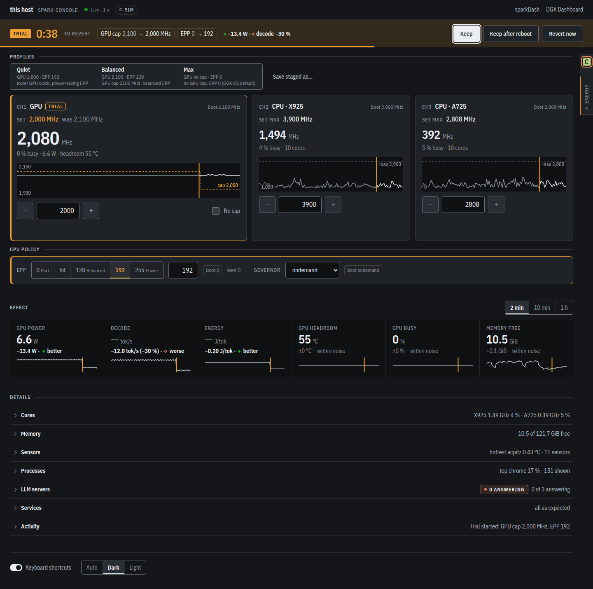

# spark-console



A small control panel for an NVIDIA DGX Spark (GB10), next to [sparkDash](https://github.com/MiaAI-Lab/sparkDash) which does the monitoring.

- **Controls:** GPU clock cap, CPU max frequency per cluster (X925 / A725), CPU EPP and governor, and profiles that set several at once.
- **Try and revert:** Apply opens a trial (30 s to 5 min). Unless you press **Keep**, the previous values come back. **Keep after reboot** writes the values into the boot units (`gb10-clocklock.service`, `cpu-epp.service`) as systemd drop-ins.
- **Effect next to the controls:** each channel shows the setpoint against the read-back clock. The effect rail shows GPU power (measured), decode tok/s and J/token from the LLM servers' `/metrics`, GPU thermal headroom, GPU busy and free memory.
- **Details on demand:** per-core clocks and load, memory pressure (PSI), all temperature sensors with min/max/avg, a process table (filter, sort, tree), LLM servers, service states and an activity log.

Python 3.12 standard library on the server, plain HTML/CSS/JS with vendored uPlot in the browser. No build step, no runtime dependencies.

## How it is put together

| Part | Runs as | Does |
|---|---|---|
| `spark_console/` server | your user (systemd user unit) | reads sysfs, `/proc`, `nvidia-smi`, LLM `/metrics`; serves the UI on a Unix socket in `$XDG_RUNTIME_DIR/spark-console/` (mode 0700) |
| `spark_console/helper.py` → `/usr/local/sbin/spark-console-helper` | root, through one sudoers line | the only code that changes hardware; accepts a fixed list of actions and checks every value |
| `tailscale serve` | tailscaled | publishes the UI on the tailnet over HTTPS |

Security model:

- The server listens on a Unix socket in a 0700 directory, so other local accounts and containers cannot connect. The tailnet is the only way in.
- Every request must carry Tailscale's `Tailscale-User-Login` header with the node owner's login. tailscaled sets this header and drops any value that the client sends. Tagged devices and Funnel traffic get no header, so they get no access.
- Requests must name a known host (DNS-rebinding guard). Changes must be JSON POSTs with `X-Spark-Console: 1` and a same-host `Origin`, so another site cannot use your browser to change clocks.
- The root helper is a root-owned copy. It never uses a shell, and it refuses anything outside its ranges: GPU 300 to 3100 MHz, EPP 0 to 255, CPU frequency inside each cluster's hardware range, and governors from the kernel's list.
- NVML cannot read a GPU clock cap back. The helper therefore writes a marker (`/run/spark-console/gpu-clock-cap`) and also sparkDash's marker (`/run/sparkdash/gpu-clock-cap`), so sparkDash shows the cap too.

## Install

Requirements:

- A DGX Spark (GB10) with DGX OS or Ubuntu 24.04, Python 3.12, git, `nvidia-smi`, and Tailscale logged in to your tailnet.
- Sudo access.

### Quick install

**CAUTION:** Read `spark_console/helper.py` before you continue. The installer lets your user run this helper as root without a password.

1. Open a terminal on the DGX Spark.
2. Run the installer:

   ```sh
   curl -fsSL https://raw.githubusercontent.com/aycandv/spark-console/main/install.sh | sh
   ```

   The installer shows what it will do, then asks `Continue? [y/N]`.

3. Type `y` and press Enter.
4. If the installer asks for your sudo password, type it and press Enter.

   The last line is the console address, `https://<node>.<tailnet>.ts.net:9443/`.

5. Open that address in a browser on a device in your tailnet.

   The header shows a green dot and `Live · 1 s`.

6. If the bar under the header starts with "Read-only", do steps 2 to 4 again.

**Note:** With `sh -s -- -y` in place of `sh`, the installer does not ask the question. `SPARK_CONSOLE_DIR` sets a different clone folder.

To read the installer before you run it:

1. Download the installer:

   ```sh
   curl -fsSLO https://raw.githubusercontent.com/aycandv/spark-console/main/install.sh
   ```

   The file `install.sh` is in the current folder.

2. Read `install.sh`.
3. Run the installer:

   ```sh
   sh install.sh
   ```

   The installer shows what it will do, then asks `Continue? [y/N]`.

4. Do steps 3 to 6 of the quick install.

To update an installed console:

1. Get the new code:

   ```sh
   git -C ~/projects/spark-console pull --ff-only
   ```

   The command prints `Already up to date.`, or `Fast-forward` and the changed files.

2. Run the installer from the clone:

   ```sh
   sh ~/projects/spark-console/install.sh
   ```

   The installer asks `Continue? [y/N]`.

3. Type `y` and press Enter.
4. If the installer asks for your sudo password, type it and press Enter.

   The installer uses the clone, installs the helper again and restarts the service. The last line is the console address.

What the installer does, in this order:

1. It checks for Python 3.12, git, nvidia-smi, systemd and Tailscale, and that Tailscale is logged in. If one is missing, it stops and changes nothing.
2. It clones https://github.com/aycandv/spark-console to `~/projects/spark-console`. This is the folder that the shipped user unit expects. If the folder exists, the installer uses it and does not overwrite it.
3. It runs `sudo deploy/install.sh`. That script:
   - copies `spark_console/helper.py` to `/usr/local/sbin/spark-console-helper`, owned by root.
   - writes the sudoers rule `/etc/sudoers.d/spark-console` for your user, and checks it with visudo first.
   - installs `gb10-clocklock.service` and `cpu-epp.service` with no GPU cap and EPP 0, the DGX OS defaults, only if they are not there. It does not replace a unit that is there.
   - turns on lingering for your user, so the user service runs without an open login session.
4. It installs the user service `spark-console` and starts it.
5. It runs `tailscale serve`, which publishes the console on your tailnet over HTTPS on port 9443. If your user may not change the Tailscale settings, it runs `sudo tailscale serve` instead.
6. It prints the console address.

What the installer never does:

- It does not change a GPU clock, a CPU frequency, an EPP value or a governor. You make each change in the console, as a trial.
- It does not open a port on your network or the internet. The server listens on a Unix socket, and tailscale serve publishes it to your tailnet only. It does not turn on Funnel.
- It does not install Python packages. The server uses the Python 3.12 standard library only.
- It uses sudo for two commands at most: `deploy/install.sh`, and `tailscale serve` if your user may not run it.

### Install step by step

Do these steps in a clone of this repository, in the clone's folder.

**CAUTION:** Step 1 gives your user password-free root access to the helper. The helper accepts only its listed actions, but read `spark_console/helper.py` before you continue.

1. Install the root helper and the sudoers rule:

   ```sh
   sudo deploy/install.sh
   ```

   The script prints `Installed /usr/local/sbin/spark-console-helper and /etc/sudoers.d/spark-console for user <you>.`

   If `gb10-clocklock.service` or `cpu-epp.service` is not in `/etc/systemd/system`, the script also installs it from `deploy/`, with no GPU cap and EPP 0 (the DGX OS defaults). The script does not replace a unit that is already there.

2. Install and start the user service:

   ```sh
   mkdir -p ~/.config/systemd/user
   sed "s|%h/projects/spark-console|$PWD|" deploy/spark-console.service > ~/.config/systemd/user/spark-console.service
   systemctl --user daemon-reload
   systemctl --user enable --now spark-console
   ```

   `systemctl --user status spark-console` shows `active (running)`.

3. Publish the UI on the tailnet:

   ```sh
   tailscale serve --bg --https=9443 unix:$XDG_RUNTIME_DIR/spark-console/http.sock
   ```

   The command prints `https://<node>.<tailnet>.ts.net:9443/`.

   If `tailscale serve` stops with an access error, run the command with sudo. To run it without sudo next time, make your user the Tailscale operator: `sudo tailscale set --operator=$USER`.

4. Open that URL in a browser on a device in your tailnet.

   The header shows a green dot and `Live · 1 s`. If the bar under the header starts with "Read-only", do step 1 again.

   **Note:** The header links go to sparkDash on port 8443 and to the DGX Dashboard on port 443 of the same tailnet name. They work only if you publish those two dashboards there with `tailscale serve`.

### Read your LLM servers

The console reads decode tokens from the Prometheus `/metrics` of vLLM, SGLang and llama.cpp server (start llama.cpp with `--metrics`). By default it reads `http://127.0.0.1:8000`, `http://127.0.0.1:30000` and `http://127.0.0.1:8080`. Do these steps if your servers use other addresses.

1. Write the addresses into a drop-in for the user service. Use one `--llm` for each server:

   ```sh
   mkdir -p ~/.config/systemd/user/spark-console.service.d
   printf '[Service]\nEnvironment="SPARK_CONSOLE_ARGS=--llm http://127.0.0.1:8001 --llm http://127.0.0.1:8002"\n' > ~/.config/systemd/user/spark-console.service.d/llm.conf
   ```

2. Restart the service:

   ```sh
   systemctl --user daemon-reload
   systemctl --user restart spark-console
   ```

   In **LLM servers**, each server that runs shows its model and decode rate.

## Use

1. Set a value with a channel stepper, the CPU policy controls or a profile.

   The value shows in amber, and the bar at the top shows the staged changes.

2. Select the trial time in **Revert after**.
3. Click **Apply**.

   The bar turns amber and counts down. The channel trace shows the new setpoint as a dashed line.

4. Look at the effect: the read-back clock, GPU power, tok/s and J/token.
5. Click **Keep**, **Keep after reboot** or **Revert now**.

   If you do nothing, the previous values come back at the end of the trial. If a revert fails, the bar shows the error and tries again every 10 s. If the server stops during a trial, it reverts the trial when it starts again (systemd restarts it after 3 s). The **Activity** section records each step.

To go back to the boot values, open **Services** and click **Re-apply boot values**. This restarts `nv-cpu-governor`, `gb10-clocklock` and `cpu-epp` in one transaction, as at boot.

### Read the energy class

The energy class is the GPU energy per token (J/token) on a scale from A to G. It is a console scale, not an EU rating.

1. Click the **Energy** tab at the right edge of the page, or press `E`. On a phone, tap the **Energy class** button at the bottom right.

   The drawer opens. It shows the class, the J/token value and the decode rate in tok/s.

2. During a trial, read the class line and the table under the ladder.

   They show the values before the trial and now, the change, and a verdict: better, worse or within noise. If the class is better but decode is slower by more than the noise, the label shows a warning.

   The verdict comes 20 s after **Apply**: 10 s for the clocks to settle, then 10 samples. Until then, the table shows "measuring". If decode is below the decode minimum (5 tok/s by default) in the trial, there is no class. The label then shows the decode change and a warning.

3. To close the drawer, press `Esc` or click **×**. On a phone, you can also tap the page above the drawer.

   The drawer is closed each time the page loads.

To change the scale, click **Edit scale** in the drawer. The scale is kept in this browser only.

### Themes and shortcuts

To change the theme, click **Auto**, **Dark** or **Light** at the bottom of the page. **Auto** follows the operating system.

| Key | Action |
|---|---|
| `A` | Apply the staged changes |
| `K` | Keep the trial |
| `B` | Keep the trial after reboot |
| `R` | Revert the trial now |
| `E` | Open or close the energy drawer |
| `Esc` | Close the energy drawer |

The trial keys work 0.6 s after the trial starts. To turn off the single-key shortcuts, click **Keyboard shortcuts** at the bottom of the page.

## Check a live console

This check is safe on the real machine. It sends no request that changes a setting.

1. Run the live check against the tailnet URL:

   ```sh
   node scripts/ui_live_check.mjs https://<node>.<tailnet>.ts.net:9443/ /tmp <your-tailnet-login>
   ```

   The last line is `ui live check: pass`. Screenshots go to `/tmp`.

## Check the boot values

Do this after a reboot, or after **Re-apply Boot Values**.

1. Run the boot check:

   ```sh
   python3 scripts/boot_check.py
   ```

   The last line is `boot check: pass`. Each `FAIL` line names the unit, value or file that is wrong.

## Uninstall

Do these steps in the folder of your clone (`~/projects/spark-console` after the quick install).

1. Remove the helper, the sudoers rule and the boot drop-ins:

   ```sh
   sudo deploy/uninstall.sh
   ```

2. Stop the service and the tailnet route:

   ```sh
   systemctl --user disable --now spark-console
   tailscale serve --https=9443 off
   ```

**Note:** The clone stays in its folder, and lingering stays on for your user.

## Develop

1. Run the unit tests:

   ```sh
   python3 -m unittest discover -s tests -t .
   ```

   The last line is `OK`.

2. Run the client unit tests (needs Node 22):

   ```sh
   node --test tests/web/*.test.mjs
   ```

   The output shows `fail 0`.

3. Start the server without hardware access:

   ```sh
   python3 -m spark_console --simulate --bind 127.0.0.1 --port 5567 --owner dev@local
   ```

   With `--simulate`, the controls change an in-memory copy. The readings are still real. Each request must send the header `Tailscale-User-Login: dev@local`.

4. Run the browser smoke check against that server (needs Node 22 and `google-chrome`):

   ```sh
   node scripts/ui_smoke.mjs http://127.0.0.1:5567/ .shots dev@local
   ```

   The last line is `ui smoke: pass`. The screenshots go to `.shots/`, in the dark and the light theme. An optional fifth argument sets the Chrome debug port (default 9333).

## License

MIT, see `LICENSE`. Vendored files and their licenses are listed in `web/vendor/README`.
